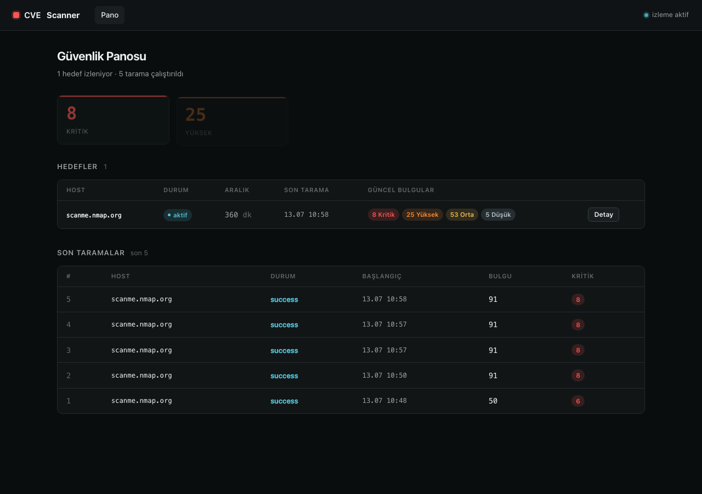
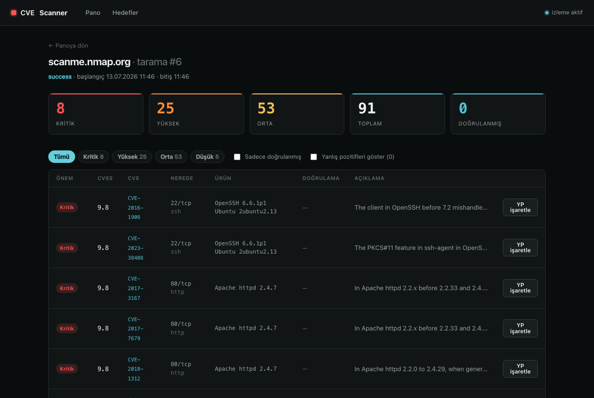
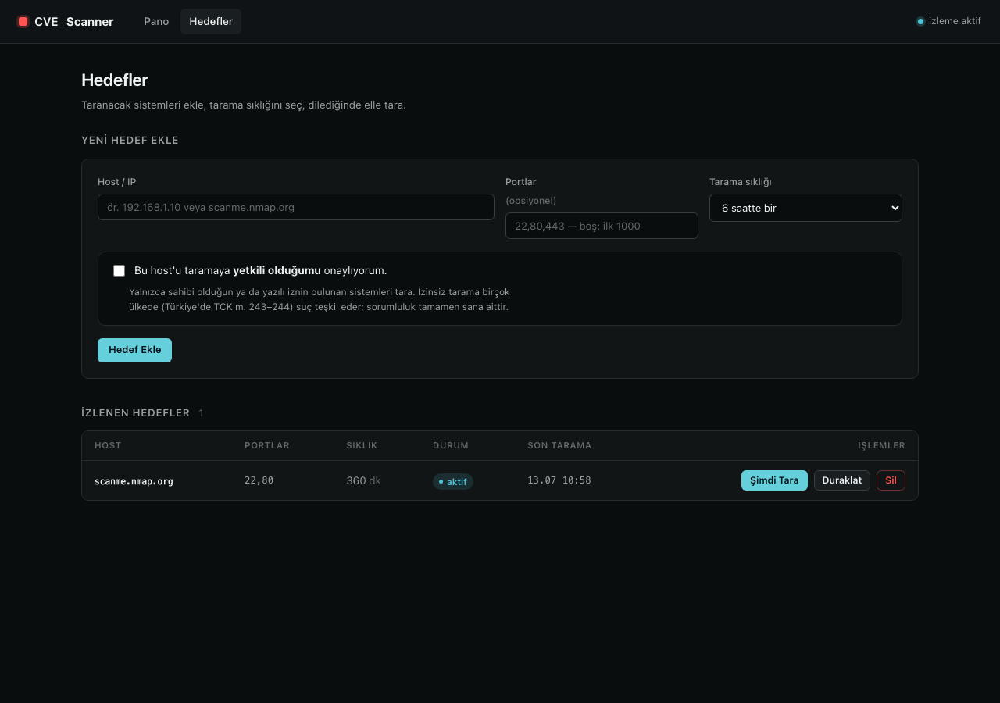

# Scry

Gizli açıkları saldırganlardan önce gör. Hedef sistemlerdeki açık servisleri ve sürümlerini tespit edip bilinen
güvenlik açıklarıyla (CVE) eşleştiren, belirlenen aralıklarla otomatik çalışan,
sonuçları bir web panosundan izlenebilen bir tarama aracı.

nmap ile servis ve sürüm tespiti yapar, NVD veritabanından CVE'leri çeker, CISA
KEV ve EPSS ile önceliklendirir, isteğe bağlı olarak nuclei ile açıkları hedefte
aktif olarak doğrular ve hepsini Flask tabanlı bir arayüzde toplar.



## ⚠️ Yetkili kullanım

Bu araç port taraması ve açık tespiti yapar. Yalnızca sahibi olduğun ya da yazılı
iznin bulunan sistemlerde kullan. İzinsiz tarama birçok ülkede suçtur; Türkiye'de
5237 sayılı TCK'nın 243 ve 244. maddeleri kapsamına girebilir.

Bu sorumluluk koda gömülüdür: bir hedef ancak arayüzden açıkça eklenip "taramaya
yetkiliyim" onayı verildikten sonra taranabilir. nuclei ile aktif doğrulama
hedefe gerçek istek gönderdiği için onu yalnızca yetkin olduğun sistemlerde aç.
Sonuçların ve sorumluluğun tamamı sana aittir; yazarlar sorumlu değildir (bkz.
LICENSE).

## Özellikler

- **Servis ve sürüm tespiti.** nmap `-sV` ile açık portları ve çalışan
  yazılımların sürümlerini bulur, CPE üretir.
- **CVE eşleştirme.** NVD API 2.0'dan CVE'leri ve CVSS skorlarını çeker; nmap'in
  CPE'si eksik ya da hatalıysa üründen kendi CPE'sini kurar.
- **Önceliklendirme.** CISA KEV (bu açık aktif olarak sömürülüyor mu?) ve EPSS
  (sömürülme olasılığı) ile her bulguyu risk sırasına koyar.
- **Aktif doğrulama.** nuclei ile CVE'leri hedefte kanıtlar; yanlış pozitifleri
  "doğrulandı" işaretinden ayırır.
- **Zamanlanmış tarama.** Her hedef kendi aralığında otomatik taranır
  (APScheduler, kalıcı iş deposu).
- **Web panosu.** Özet, hedef yönetimi, filtreli tarama detayı, iki tarama
  arasındaki değişim (diff) ve yazdırılabilir rapor.
- **Uyarılar.** Yeni bir kritik ya da KEV açık çıkınca webhook (Slack/Discord)
  veya e-posta bildirimi.

| Tarama detayı | Hedef yönetimi |
|---|---|
|  |  |

## Nasıl çalışır

```
nmap (-sV)  ->  NVD (CVE + CVSS)  ->  KEV + EPSS  ->  nuclei  ->  SQLite + web
  sürüm          olası açıklar        risk          kanıt        izleme
```

Her adım ayrı bir Python modülüdür ve tek başına çalıştırılabilir. Bu, projeyi
okuyarak öğrenmeyi kolaylaştırır.

## Gereksinimler

- Python 3.11+
- [nmap](https://nmap.org/): servis ve sürüm tespiti (zorunlu)
- [nuclei](https://github.com/projectdiscovery/nuclei): aktif doğrulama
  (opsiyonel; kurulu değilse bu adım atlanır)

```bash
# macOS
brew install nmap nuclei
nuclei -update-templates
```

## Kurulum

```bash
git clone <repo-url> scry
cd scry

python3 -m venv .venv
source .venv/bin/activate
pip install -r requirements.txt

cp .env.example .env   # ardından .env'i düzenle (aşağıya bak)
```

## Kullanım

```bash
python run.py          # http://127.0.0.1:5001
```

Arayüzde **Hedefler** sekmesine gidip bir host ekle (yetki onayını işaretle) ve
tarama sıklığını seç. Tarama otomatik çalışır; "Şimdi Tara" ile elle de
tetikleyebilirsin. Sonuçlar panoda ve tarama detayında görünür.

Komut satırından tek seferlik tarama:

```bash
python -m core.scan_runner scanme.nmap.org 22,80
```

## Yapılandırma (.env)

| Değişken | Açıklama |
|---|---|
| `NVD_API_KEY` | NVD API anahtarı (opsiyonel; hız limitini yükseltir) |
| `NUCLEI_VERIFY` | Aktif doğrulamayı açar/kapatır (`true`/`false`) |
| `ENRICH` | KEV ve EPSS önceliklendirmesini açar/kapatır |
| `ALERT_WEBHOOK_URL` | Slack/Discord webhook (boşsa uyarı gönderilmez) |
| `SMTP_*`, `ALERT_TO` | E-posta uyarıları için SMTP ayarları |

Ücretsiz NVD anahtarı: https://nvd.nist.gov/developers/request-an-api-key

## Proje yapısı

```
scanner/   nmap, NVD istemcisi, eşleştirme, nuclei doğrulama, zenginleştirme
core/      veri modeli, veritabanı, orkestrasyon, zamanlayıcı, uyarılar
web/       Flask app, route'lar, şablonlar
config.py  ayarlar ve hedef izin mantığı
run.py     çalıştırma noktası
```

## Lisans

MIT. Bkz. [LICENSE](LICENSE).
